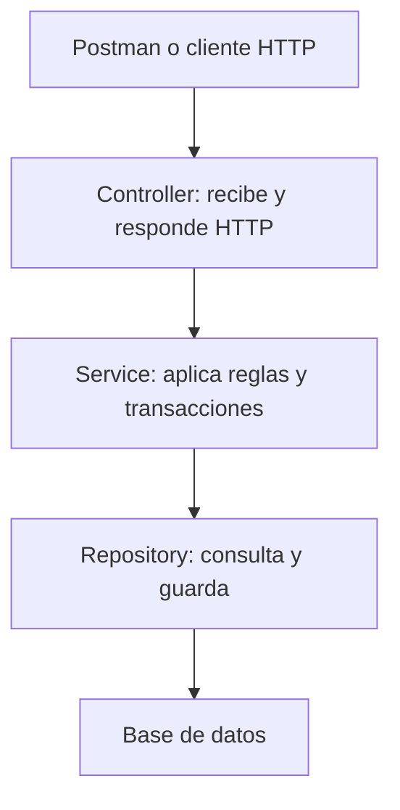

# API REST de eventos y asistentes

Proyecto académico de Programación II. Permite administrar eventos y asistentes y registrar sus inscripciones mediante una relación **muchos a muchos (N:N)**.

## Entrega desde este repositorio

Repositorio del proyecto: **[jazapata726-bit/parcial-corte-2](https://github.com/jazapata726-bit/parcial-corte-2)**. Este proyecto reúne el código, la documentación y las evidencias de una API desplegada y verificada en AWS.

| Elemento de la entrega | Ubicación |
| --- | --- |
| Código y arquitectura en capas | [src/main/java/com/parcial/eventos](src/main/java/com/parcial/eventos) |
| Dockerfile y ejecución con PostgreSQL | [Dockerfile](Dockerfile) y [compose.yaml](compose.yaml) |
| Colección y entorno de Postman | [postman](postman) |
| Resultados de las pruebas realizadas | [evidencias](evidencias/README.md) |
| Modelo y explicación para sustentar | [Diseño y sustentación](docs/DISENO_Y_SUSTENTACION.md) |
| Configuración de AWS | [Plantilla CloudFormation](aws/eventos-stack.json) |
| Guía de despliegue | [Desplegar en AWS](aws/DESPLEGAR_AWS.md) |
| URL pública de la API | [http://13.59.121.203](http://13.59.121.203) |
| Estado de salud | [HTTP 200 y status UP](http://13.59.121.203/actuator/health) |
| Pruebas sobre AWS | [33 solicitudes, 47 comprobaciones, 0 fallos](evidencias/05-aws-resumen.json) |
| Datos y comprobación de entrega | [ENTREGA.md](ENTREGA.md) |

**Estado de la API:** desplegada en AWS EC2, con Docker y PostgreSQL. Verificada el 23 de octubre de 2026: salud UP y 47 comprobaciones de Postman aprobadas sobre la URL pública. Las 14 pruebas de integración también aprobaron en local.

**Probar la nube en Postman:** importa la colección y el [entorno AWS](postman/Eventos_AWS.postman_environment.json), que ya incluye la dirección de la API.

El dominio es **Eventos**, con las entidades **Evento** y **Asistente** y una relación **N:N**. Los campos y las reglas se describen a continuación.

## Tecnologías

| Herramienta | Uso |
| --- | --- |
| Java 17 | Lenguaje y versión de compilación |
| Spring Boot 3.5.16 | Aplicación y servidor HTTP |
| Spring Web | Controladores REST |
| Spring Data JPA / Hibernate | Persistencia y relación N:N |
| Jakarta Validation | Validación de entradas |
| H2 en archivo | Base local, sin instalación adicional |
| PostgreSQL | Base para Docker Compose y nube |
| Maven Wrapper 3.9.11 | Compilación reproducible sin instalar Maven |
| Docker | Imagen con compilación y ejecución en etapas separadas |
| JUnit / MockMvc | Pruebas de integración HTTP y persistencia |

## Modelo

| Entidad | Campos |
| --- | --- |
| Evento | `id`, `nombre`, `fecha`, `lugar` |
| Asistente | `id`, `nombre`, `correo`, `telefono` |
| Tabla intermedia | `evento_asistente`: `evento_id`, `asistente_id` |

Un evento puede tener varios asistentes y un asistente puede participar en varios eventos. La tabla intermedia representa las inscripciones y es generada por JPA; no es una tercera entidad Java. No necesitas crear las tablas manualmente.

`fecha` es una fecha y hora local sin zona horaria: por ejemplo, `2027-01-15T09:00:00`.

## Arquitectura en capas



`Entity` representa las tablas y sus relaciones. Los DTO definen el JSON de entrada y salida, evitando referencias circulares al consultar la relación N:N.

```text
src/main/java/com/parcial/eventos/
  EventosApiApplication.java
  controller/   EventoController, AsistenteController, InicioController
  service/      EventoService, AsistenteService
  repository/   EventoRepository, AsistenteRepository
  entity/       Evento, Asistente
  dto/          Request y Response de cada entidad
  exception/    Excepciones y respuestas de error
```

## Inicio rápido en Windows / IntelliJ

1. Extrae el ZIP. En IntelliJ selecciona **File > Open** y abre la carpeta `eventos-api`, la que contiene `pom.xml`.
2. Importa el proyecto como **Maven** y espera la descarga de dependencias.
3. En **File > Project Structure > Project SDK**, selecciona **JDK 17**.
4. Abre `src/main/java/com/parcial/eventos/EventosApiApplication.java`.
5. Ejecuta su método `main` con el botón verde.
6. Abre <http://localhost:8080/api/eventos>. En una base nueva verás `[]`.
7. Abre <http://localhost:8080/actuator/health>. Debe responder `{"status":"UP"}`.

La primera ejecución necesita conexión a internet para descargar dependencias. La base local se guarda en `data/`, relativa a la carpeta de ejecución. No debes subirla al repositorio.

Alternativa desde PowerShell, situado en la carpeta que contiene `pom.xml`:

```powershell
.\mvnw.cmd spring-boot:run
```

En Linux o macOS:

```bash
chmod +x mvnw
./mvnw spring-boot:run
```

Para compilar y ejecutar las pruebas:

```powershell
.\mvnw.cmd clean verify
java -jar target/eventos-api.jar
```

Detén la ejecución anterior antes de iniciar otra en el mismo puerto.

## Endpoints

URL local: `http://localhost:8080`. Todas las solicitudes con cuerpo usan `Content-Type: application/json`.

| Método | Ruta | Acción | Respuesta correcta |
| --- | --- | --- | --- |
| GET | `/` | Información de la API | 200 |
| GET | `/actuator/health` | Estado de la aplicación y la base | 200 |
| POST | `/api/eventos` | Crear evento | 201 + Location |
| GET | `/api/eventos` | Listar eventos | 200 |
| GET | `/api/eventos/{id}` | Consultar evento | 200 |
| PUT | `/api/eventos/{id}` | Reemplazar datos del evento | 200 |
| DELETE | `/api/eventos/{id}` | Eliminar evento y sus inscripciones | 204 |
| POST | `/api/asistentes` | Crear asistente | 201 + Location |
| GET | `/api/asistentes` | Listar asistentes | 200 |
| GET | `/api/asistentes/{id}` | Consultar asistente | 200 |
| PUT | `/api/asistentes/{id}` | Reemplazar datos del asistente | 200 |
| DELETE | `/api/asistentes/{id}` | Eliminar asistente y sus inscripciones | 204 |
| POST | `/api/eventos/{eventoId}/asistentes/{asistenteId}` | Inscribir asistente | 201 + Location |
| GET | `/api/eventos/{eventoId}/asistentes` | Listar asistentes del evento | 200 |
| GET | `/api/eventos/{eventoId}/asistentes/{asistenteId}` | Consultar una inscripción | 200 |
| DELETE | `/api/eventos/{eventoId}/asistentes/{asistenteId}` | Retirar inscripción | 204 |
| GET | `/api/asistentes/{asistenteId}/eventos` | Listar eventos del asistente | 200 |

`PUT` recibe todos los campos obligatorios de la entidad y conserva sus inscripciones. Para cambiar las inscripciones se utilizan las rutas específicas de la relación.

### Crear un evento

Selecciona **POST**, URL `http://localhost:8080/api/eventos`, **Body > raw > JSON**:

```json
{
  "nombre": "Conferencia de tecnología",
  "fecha": "2027-01-15T09:00:00",
  "lugar": "Auditorio principal"
}
```

Respuesta de ejemplo en una base nueva:

```json
{
  "id": 1,
  "nombre": "Conferencia de tecnología",
  "fecha": "2027-01-15T09:00:00",
  "lugar": "Auditorio principal",
  "asistentesIds": []
}
```

### Crear un asistente

**POST** `http://localhost:8080/api/asistentes`:

```json
{
  "nombre": "Ana Pérez",
  "correo": "ana@example.com",
  "telefono": "3001234567"
}
```

### Inscribir y consultar

Usa los identificadores que recibiste; no supongas que siempre serán 1.

```http
POST /api/eventos/1/asistentes/1
GET /api/eventos/1/asistentes
GET /api/asistentes/1/eventos
DELETE /api/eventos/1/asistentes/1
```

El POST de inscripción no lleva cuerpo. Un DELETE exitoso responde 204 sin JSON.

## Reglas y errores

- El nombre, la fecha y el lugar del evento son obligatorios.
- El nombre y un correo con formato válido son obligatorios para el asistente; el teléfono es opcional.
- El correo es único y se almacena en minúsculas.
- No se puede repetir la misma inscripción.
- Eliminar un evento conserva los asistentes. Eliminar un asistente conserva los eventos. En ambos casos se retiran las inscripciones correspondientes.
- Un listado vacío devuelve `[]` con 200. Un identificador inexistente devuelve 404.
- Se rechazan campos JSON desconocidos para detectar nombres escritos incorrectamente.

| Código | Significado |
| --- | --- |
| 200 | Consulta o actualización correcta |
| 201 | Recurso creado |
| 204 | Eliminación correcta, sin cuerpo |
| 400 | Datos, fecha, JSON o identificador inválidos |
| 404 | Evento, asistente o inscripción inexistente |
| 409 | Correo o inscripción duplicados |

Ejemplo de error de validación (la fecha de respuesta cambia):

```json
{
  "fecha": "2026-10-23T17:00:00Z",
  "estado": 400,
  "error": "Bad Request",
  "mensaje": "Revisa los datos enviados",
  "ruta": "/api/asistentes",
  "campos": { "correo": "El correo no tiene un formato válido" }
}
```

## Postman

Importa `postman/Eventos_API.postman_collection.json` e importa y selecciona `postman/Eventos_Local.postman_environment.json`.

La colección guarda los identificadores devueltos al crear registros y utiliza correos diferentes en cada ejecución. Puedes ejecutar la colección completa en orden; termina eliminando sus propios datos de demostración. Incluye pruebas de la relación N:N y de respuestas 400, 404 y 409.

Para la nube, cambia únicamente `baseUrl` por el dominio real, con `https://` y sin barra al final. No escribas el método HTTP dentro del campo URL.

## Docker: solo la API con H2

Con Docker Desktop abierto, ejecuta desde la raíz del proyecto:

```powershell
docker build -t eventos-api:1.0 .
docker run -d --name eventos-api-demo -p 8080:8080 -v eventos_h2:/app/data eventos-api:1.0
docker logs -f eventos-api-demo
```

El volumen conserva los datos de H2 al recrear el contenedor. Comprueba <http://localhost:8080/actuator/health>. `Ctrl+C` sale del seguimiento de logs y no detiene el contenedor.

```powershell
docker stop eventos-api-demo
docker rm eventos-api-demo
```

El Dockerfile compila y ejecuta las pruebas en una etapa con Maven; la imagen final contiene Java y el JAR. La aplicación se ejecuta con un usuario sin privilegios.

## Docker Compose: API y PostgreSQL

Para probar el mismo motor de base de datos que se usará en la nube:

```powershell
Copy-Item .env.example .env
```

Edita `.env` y cambia la contraseña de ejemplo. Luego:

```powershell
docker compose up -d --build
docker compose logs -f api
```

Comprueba las mismas URLs locales. Para detener ambos servicios conservando la base:

```powershell
docker compose down
```

Compose utiliza PostgreSQL en su volumen `postgres_data`. Esta base es independiente de la base H2 local. Si el puerto 8080 está ocupado, detén la API que dejaste abierta en IntelliJ o el contenedor de la prueba anterior.

## Nube: AWS EC2 + Docker + PostgreSQL

La plantilla `aws/eventos-stack.json` crea una VPC, una subred pública, un grupo de seguridad y una instancia EC2 con Amazon Linux 2023. La instancia instala Docker, compila la imagen, ejecuta las pruebas y arranca la API junto con PostgreSQL. El código necesario está incluido en la plantilla.

El procedimiento está en `aws/DESPLEGAR_AWS.md`. La opción inicial de la guía es la región Ohio (`us-east-2`). Se utiliza una instancia `t3.micro` con disco cifrado de 16 GiB y 2 GiB de memoria de intercambio para apoyar la compilación. EC2, EBS e IPv4 pueden generar cargos; verifica el plan y los créditos de tu cuenta antes de crear recursos.

El puerto HTTP 80 publica la API; PostgreSQL se mantiene en la red interna de Docker. La contraseña de la base se genera dentro del servidor. Compose configura el perfil `prod` con `DB_URL`, `DB_USERNAME` y `DB_PASSWORD`; no debes escribir credenciales en el repositorio.

CloudFormation espera una señal de éxito después de que `/actuator/health` responda correctamente. Cuando la pila llegue a `CREATE_COMPLETE`, sus **Outputs** contienen `ApiUrl`, `HealthUrl`, `EventosUrl` e `InstanceId`. Usa ApiUrl como `baseUrl` en Postman y como enlace del despliegue en la entrega.

La API se publica por HTTP. La IP y su nombre DNS pueden cambiar al detener e iniciar la instancia; conserva el servidor activo durante la revisión del profesor. El volumen de PostgreSQL conserva los datos al reiniciar contenedores o la instancia. Eliminar la pila también elimina el disco.

Después de modificar el código, vuelve a generar la plantilla con `python3 scripts/generar_plantilla_aws.py`.

## Criterios del parcial

| Criterio recibido | Implementación o evidencia |
| --- | --- |
| Dos entidades relacionadas | `Evento`, `Asistente`, relación N:N |
| Capas Controller, Service, Repository, Entity | Paquetes separados en `src/main/java` |
| Dockerfile funcional | Imagen compilada y contenedores iniciados en AWS EC2; `Dockerfile` y `compose.yaml` incluidos |
| Despliegue cloud | [API en AWS EC2](http://13.59.121.203), perfil `prod`, Docker y PostgreSQL |
| CRUD completo y README | Endpoints de ambas entidades y este archivo |
| Repositorio + enlace funcionando | [Repositorio](https://github.com/jazapata726-bit/parcial-corte-2) y [API pública](http://13.59.121.203); enlaces reunidos en `ENTREGA.md` |

El alcance y los resultados de la verificación están en [docs/VALIDACION.md](docs/VALIDACION.md). Los informes locales y de AWS están en [evidencias](evidencias/README.md).

## Documentación incluida

- `GUIA_PASO_A_PASO.md`: ejecución, Postman, Docker, GitHub, nube y evidencias.
- `docs/DISENO_Y_SUSTENTACION.md`: modelo, capas y explicación para la sustentación.
- `docs/VALIDACION.md`: pruebas realizadas y alcance de la verificación.
- `ENTREGA.md`: enlaces reales, resultados y archivos de entrega.
- `aws/eventos-stack.json`: infraestructura y arranque automático en AWS.
- `aws/DESPLEGAR_AWS.md`: procedimiento de publicación y evidencias en AWS.

## Verificación automática en GitHub

Al publicar el proyecto en la rama `main`, `.github/workflows/verificar-api.yml` construye el Dockerfile, inicia la API con PostgreSQL usando Compose, ejecuta Postman y comprueba que las inscripciones persistan al reiniciar el contenedor. El resultado aparece en **Actions** y el informe JSON de Postman queda como artefacto descargable. Consulta la [ejecución más reciente](https://github.com/jazapata726-bit/parcial-corte-2/actions/workflows/verificar-api.yml) para ver su resultado.

## Fuentes oficiales

Consultadas el 23 de octubre de 2026:

- [Requisitos de Spring Boot 3.5](https://docs.spring.io/spring-boot/3.5/system-requirements.html).
- [EC2 en CloudFormation](https://docs.aws.amazon.com/AWSCloudFormation/latest/TemplateReference/aws-resource-ec2-instance.html).
- [Señal de arranque cfn-signal](https://docs.aws.amazon.com/AWSCloudFormation/latest/TemplateReference/cfn-signal.html).
- [Docker en Amazon Linux 2023](https://docs.aws.amazon.com/AmazonECS/latest/developerguide/create-container-image.html).
- [AWS Free Tier](https://aws.amazon.com/free/).
