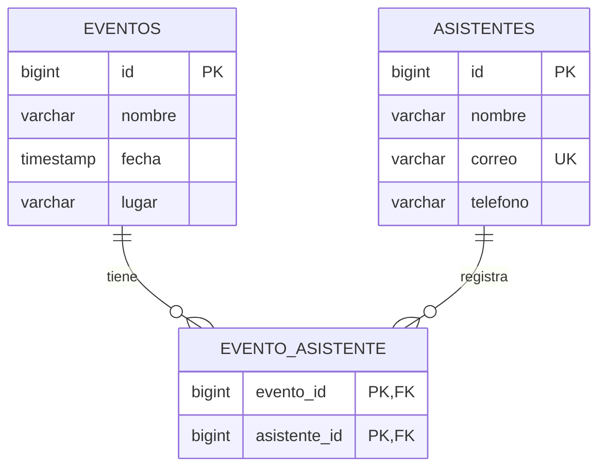

# Diseño y explicación del proyecto

## Descripción

La API permite registrar eventos y asistentes, modificar sus datos y gestionar las inscripciones. Una persona puede participar en varios eventos y cada evento puede reunir a varias personas. Las operaciones están disponibles por HTTP y responden en JSON.

Se proponen los campos siguientes porque la imagen recibida solo especifica las entidades y la relación.

## Diccionario de datos

| Tabla | Campo | Tipo lógico | Regla |
| --- | --- | --- | --- |
| eventos | id | Entero largo | Clave primaria generada |
| eventos | nombre | Texto, máximo 120 | Obligatorio, no vacío |
| eventos | fecha | Fecha y hora local | Obligatoria; formato ISO |
| eventos | lugar | Texto, máximo 150 | Obligatorio, no vacío |
| asistentes | id | Entero largo | Clave primaria generada |
| asistentes | nombre | Texto, máximo 100 | Obligatorio, no vacío |
| asistentes | correo | Texto, máximo 150 | Obligatorio, formato válido y único |
| asistentes | telefono | Texto, máximo 30 | Opcional |
| evento_asistente | evento_id | Entero largo | Referencia a eventos.id |
| evento_asistente | asistente_id | Entero largo | Referencia a asistentes.id |

La pareja `evento_id, asistente_id` identifica una inscripción y no se puede repetir.

## Qué hace cada capa

| Capa | Archivo de ejemplo | Responsabilidad |
| --- | --- | --- |
| Controller | EventoController.java | Recibir solicitudes, validar el cuerpo y devolver el estado HTTP |
| Service | EventoService.java | Aplicar reglas: buscar registros, impedir inscripciones duplicadas, asociar y retirar |
| Repository | EventoRepository.java | Acceder a la base mediante JpaRepository |
| Entity | Evento.java | Definir columnas y relación con Asistente |
| DTO | EventoRequest.java / EventoResponse.java | Definir qué datos se reciben y se devuelven |
| Exception | GlobalExceptionHandler.java | Convertir errores de validación y negocio a respuestas HTTP |

Por ejemplo, al recibir `POST /api/eventos/1/asistentes/2`:

1. `EventoController` recibe los identificadores 1 y 2.
2. `EventoService` comprueba que ambos registros existan y que la inscripción no se repita.
3. El servicio modifica la relación del evento y conserva ambos lados de la relación Java.
4. `EventoRepository` permite que JPA guarde el cambio en `evento_asistente`.
5. El controlador devuelve 201 y la representación del evento con sus identificadores de asistentes.

## Anotaciones que debes poder explicar

| Anotación | Explicación |
| --- | --- |
| `@SpringBootApplication` | Marca la clase que inicia y configura la aplicación |
| `@RestController` | Expone operaciones HTTP que devuelven datos |
| `@RequestMapping` | Define el prefijo de ruta del controlador |
| `@GetMapping` / `@PostMapping` / `@PutMapping` / `@DeleteMapping` | Asocian un método Java con una operación HTTP |
| `@PathVariable` | Obtiene un valor de la ruta, como el identificador |
| `@RequestBody` | Convierte el JSON enviado en un objeto Java |
| `@Valid` | Comprueba las restricciones del DTO recibido |
| `@Service` | Identifica una clase de lógica del negocio |
| `@Transactional` | Agrupa una operación de base para confirmar todo o revertir ante un error |
| `@Entity` / `@Table` | Representan una tabla mediante una clase |
| `@Id` / `@GeneratedValue` | Definen una clave primaria generada |
| `@ManyToMany` | Modela la relación N:N |
| `@JoinTable` | Define la tabla intermedia y sus claves foráneas |
| `mappedBy = "asistentes"` | Indica que Evento administra la relación |
| `@RestControllerAdvice` | Centraliza las respuestas ante excepciones |

Los Repository son interfaces. Spring Data crea su implementación; por eso no hay que escribir el SQL del CRUD básico.

## Por qué se usan DTO

Las entidades se apuntan entre sí: Evento tiene asistentes y Asistente tiene eventos. Devolver directamente ambas colecciones podría producir un JSON que se repite indefinidamente. Los DTO de respuesta devuelven los datos básicos y una lista de identificadores. Los endpoints específicos permiten consultar los detalles de la relación.

## Cómo se protege la relación al eliminar

La relación no utiliza `CascadeType.REMOVE`. Primero se retiran las inscripciones y luego se elimina la entidad pedida. Si se elimina el evento A, sus asistentes siguen disponibles y pueden conservar sus inscripciones al evento B.

## Docker y nube

- **Imagen:** paquete con lo necesario para ejecutar la aplicación. Se construye con `docker build`.
- **Contenedor:** ejecución de esa imagen. Se inicia con `docker run`.
- **Dockerfile:** instrucciones para compilar y preparar la imagen.
- **Construcción en dos etapas:** Maven compila y prueba; Java ejecuta el JAR en la imagen final.
- **Volumen:** guarda datos fuera del ciclo de vida del contenedor.
- **Variable de entorno:** configuración que se suministra al ejecutar, como credenciales y puerto.
- **Perfil local:** usa H2 en archivo.
- **Perfil prod:** usa PostgreSQL con las variables configuradas en la plataforma.

## Guion breve de sustentación

“Mi proyecto es una API REST para administrar eventos y asistentes. La relación es muchos a muchos, porque un evento tiene varias personas y una persona puede participar en varios eventos. Esa relación se guarda en la tabla evento_asistente.

Organicé el código en cuatro capas principales. Controller recibe las solicitudes HTTP; Service aplica las reglas; Repository accede a la base de datos; Entity representa las tablas. Los DTO controlan los datos de entrada y salida.

Implementé crear, consultar, actualizar y eliminar para las dos entidades. También puedo inscribir y retirar asistentes. El sistema valida los datos, evita correos e inscripciones duplicadas y devuelve códigos HTTP según el resultado.

Para ejecutar la aplicación utilizo Java 17 y Spring Boot. El Dockerfile compila el proyecto, ejecuta las pruebas y prepara una imagen que arranca el JAR. Para la nube está configurado el perfil prod con PostgreSQL y variables de entorno.”

Después de desplegar, agrega con tus palabras dónde la publicaste y muestra la URL real. Practica la demostración: crear dos eventos, crear dos asistentes, registrar tres inscripciones y consultar la relación en ambos sentidos.
